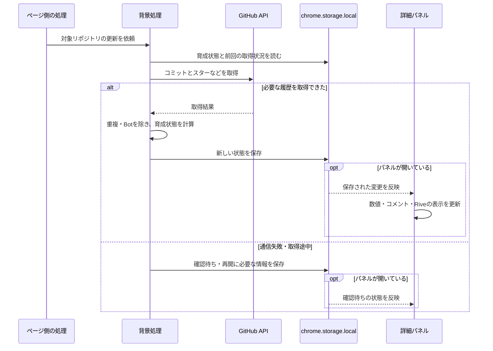

# Chrome拡張機能：WXT・保存・動作タイミング

[技術一覧へ戻る](../README.md#technologies) · [Riveの説明へ](rive.md)

Chrome拡張機能としての構成と、データの取得・保存・表示の流れを説明します。

## Chrome拡張機能の構成

Chrome拡張機能は、ブラウザーに追加する小さなアプリです。ページ上の表示、背景での処理、データの保存を組み合わせて動きます。pushttiでは、次のように担当を分けます。

| 担当 | 動く場所 | pushttiで行うこと |
| --- | --- | --- |
| Content Script | GitHubのページ側 | リポジトリの識別、開閉ボタンの設置、更新タイミングの管理 |
| Service Worker | 拡張機能の背景処理 | GitHubの情報取得、育成状態の計算、状態の保存 |
| 詳細パネル | 拡張機能側の画面 | キャラ・コメント・経験値・歴代キャラの表示 |
| 保存領域 | Chrome内 | 育成状態・同期状況・歴代キャラのデータを保持 |

Content Scriptから背景処理へは、拡張機能内のメッセージで「このリポジトリを更新して」と依頼します。背景処理で得られた状態を保存し、詳細パネルへ反映します。

## WXT

**Chrome拡張機能を作りやすくする、開発用の土台・道具セットです。**

拡張機能には、画面、GitHubページへ表示を追加する処理、情報を取得する処理、Chrome向けの設定などが必要です。WXTは、これらを整理し、書いたプログラムをChromeで動く形にまとめる作業を助けます。

pushttiでは、TypeScriptで処理を書き、Reactでパネルを作ります。それらをWXTでChrome拡張としてまとめます。画面の表示に必要なプログラムやRiveの再生機能も、拡張機能へ同梱します。

WXT自体がGitHubの情報を取得したり、経験値を保存したりするわけではありません。その処理は、WXTを使って開発するpushtti側が担当します。

参考：[WXT公式の紹介](https://wxt.dev/guide/introduction.html)、[ページへの画面の追加](https://wxt.dev/guide/essentials/content-scripts.html)

### 開発時と利用時の違い

1. 開発者がTypeScriptで処理を書き、Reactで画面を作る。
2. WXTで、それらをChromeが読み込める拡張機能のファイルへまとめる。この作業を「ビルド」と呼ぶ。
3. 利用者のChromeが、出来上がった拡張機能を読み込む。
4. 利用時は、拡張機能に含まれるページ側の処理・背景処理・画面が、それぞれ必要な時に動く。

利用者がGitHubを開くたびに、WXTの開発用コマンドを実行する必要はありません。キャラのデータも、[Rive CLI](rive.md#cli)で制作したものをビルド時に同梱する方針です。

## Chrome内にデータを保存する仕組み

### chrome.storage.local：育成情報を保存する

**Chrome拡張専用の保存場所です。**「経験値は120」「現在は2代目」のような情報を、名前と値の組み合わせで保存できます。

pushttiでは、現在の経験値・進化段階・誕生日時・最後の餌の日時に加え、更新状況や歴代キャラの情報を保存します。Chromeを閉じてもデータは残り、次に開いた時に読み戻せます。

主な特徴は次のとおりです。

- 拡張機能の画面や背景処理から利用できる。
- 通常の閲覧履歴やキャッシュを消しても、保存したデータは残る。
- 標準の保存容量は10MB。
- 拡張機能を削除すると、その保存データも削除される。

今回は端末内だけに保存します。別端末との同期や、バックアップの書き出し・読み込みは初版には含めません。

参考：[Chrome公式のStorage API](https://developer.chrome.com/docs/extensions/reference/api/storage)

### IndexedDB：歴代キャラの画像を保存する

**ブラウザー内で動くデータベースです。** 画像のようなデータを保存する用途に向いています。

歴代キャラは、種類・色・進化段階だけでなく、最後の姿を画像でも残す設計です。数値や日時は `chrome.storage.local`、画像はIndexedDBへ分けて保存します。画像を取り出すための識別子を、歴代キャラの情報に持たせます。

IndexedDBもデータベースですが、外部サーバーは不要です。「外部DBなし」と「ブラウザー内のIndexedDBを使う」は両立します。こちらも拡張機能の削除後に残るバックアップではありません。

参考：[Chrome拡張機能内の保存領域](https://developer.chrome.com/docs/extensions/develop/concepts/storage-and-cookies)、[MDN：IndexedDB](https://developer.mozilla.org/ja/docs/Web/API/IndexedDB_API)

### ほかの保存方法との違い

| 技術 | 特徴 | pushttiでの扱い |
| --- | --- | --- |
| `chrome.storage.local` | 拡張機能向けの、端末内の保存場所 | 育成状態・同期状況・歴代情報に使う |
| IndexedDB | 画像なども扱えるブラウザー内DB | 歴代キャラの画像に使う |
| `chrome.storage.sync` | Chromeの同期機能を使えるが、保存容量が小さい | 初版では使わない |
| `localStorage` | 一般的なWebページでも使う簡易保存機能。背景処理のService Workerからは使えない | 初版では使わない |

GitHubページの `localStorage` に育成情報を保存するのではなく、拡張機能自身の保存領域を使います。

### 保存する情報の具体例

| 保存する情報 | 例・用途 |
| --- | --- |
| 現在の育成状態 | 経験値120、成長期、2代目 |
| 日時 | 誕生日、最後の餌の日時、死亡日 |
| 同期状況 | 最後に確認できた時刻、取得途中の続き、計上済みコミット |
| 歴代キャラ | 最終経験値、進化段階、固定色、使用した素材のバージョン |
| 歴代画像への参照 | IndexedDBに保存した画像を取り出すための識別子 |

保存は「その場で画面に表示すること」とは別の処理です。パネルが閉じていても、GitHubの情報取得と育成計算が完了したら状態を保存します。次にパネルを開いた時、その保存結果を読み出すことで、最新の状態を表示できます。

Service Workerは途中で停止することがあるため、経験値や取得途中の情報を、その処理のメモリだけに置かない設計にします。Chrome内に保存しておけば、次の起動時に続きから扱えます。

## Chrome拡張として、いつ・どこが動くか

### 1. GitHubの公開リポジトリを開く

**Content Script**という、ページ側で動く処理がリポジトリを識別し、右下に開閉ボタンを置きます。GitHub内で別のリポジトリへ移動した場合も、表示対象を切り替えます。

最初はボタンだけを表示します。押すと、GitHub本体の画面とは分けた拡張機能側の領域（iframe）に詳細パネルを開きます。未育成なら「育てる」を押して誕生させます。

### 2. 育成中のリポジトリの情報を確認する

ページを開いた時、ページが表示されている間の15分ごと、手動の更新ボタンを押した時に、ページ側から背景処理へ更新を依頼します。パネルが閉じていても、対象ページが表示されていれば更新対象です。

**Service Worker**という背景処理が、GitHub APIからブランチ・コミット・スターを取得します。APIは、GitHubの情報をプログラムから読み取るための窓口です。取得済みの情報は再利用し、同じリポジトリを複数タブで開いていても取得を共通化します。

Service Workerは必要な時に動く仕組みです。常に起動している前提にはせず、次回の処理に必要な情報は保存しておきます。

参考：[ChromeのContent Scripts](https://developer.chrome.com/docs/extensions/develop/concepts/content-scripts)、[Service Workerのライフサイクル](https://developer.chrome.com/docs/extensions/develop/concepts/service-workers/lifecycle)

将来は「自分のリポジトリだけ育成できる」制約を追加します。その段階では、GitHubの認証で利用者本人を確認し、対象リポジトリの所有者と照合する処理を加える想定です。これは、公開情報を取得する初版の処理とは別に追加します。

### 3. 育成状態を計算し、保存する

必要なコミット履歴を取得できたら、同じコミットの重複とBotのコミットなどを除き、経験値・進化・体調・死亡を判定します。計算した結果は `chrome.storage.local` に保存します。

通信失敗や取得途中は、コミットが0件だったことにはしません。「確認待ち」とし、取得できていない期間を根拠に死亡を確定しない設計です。

GitHub側の取得回数制限に達した場合も、続きから確認できるように待機します。15分ごとの更新は確認するタイミングであり、毎回必ず新しい情報を取得できることを保証するものではありません。

参考：[GitHub APIの回数制限](https://docs.github.com/en/rest/using-the-rest-api/rate-limits-for-the-rest-api)

### 4. パネルに結果を表示する

パネルを開いた時は、保存済みの状態を読み出します。更新中なら、その状況も表示します。パネル表示中に育成状態が更新されたら、数値・キャラ・コメントへ反映します。

キャラはRive Webランタイムで描き、経験値などの文字情報とコメントはReactで表示します。コメントは、パネルを開いた時と、新しい餌・スター増加・進化・体調変化を確認した時に表示します。

歴代キャラの姿を画像化する処理は、描画できるパネル側が担当します。背景処理が直接キャラを描くわけではありません。パネルが閉じている時に死亡を判定した場合も、まず姿を再現する情報を保存し、描画できる時に履歴用画像を作成します。

### 5. Chromeを閉じる・次に開く

Chromeを閉じている間は、この拡張機能からGitHubへの確認やキャラの描画は行いません。ただし、育成ルール上の時間は進みます。次に対象リポジトリを開いた時、取得できるコミット履歴を日時順に確認して、その間の成長や死亡を判定します。

30日間餌になるコミットがなければ、その時点で死亡した扱いです。その後にコミットがあっても同じキャラは復活せず、新しい世代を始めます。

未取得の作業ブランチが既定ブランチへ取り込まれずに削除されるなど、後から取得できないコミットは餌に数えられない場合があります。初版ではローカル動作を優先し、取得できた履歴を基準に判定します。

## 具体例：コミットが餌になるまで

1. 開発者がコミットし、GitHubへpushする。手元だけにあるコミットは取得対象にならない。
2. 次の更新タイミングで、背景処理がGitHubのコミットを取得する。
3. 未計上で、人による対象コミットなら、経験値10を加算し、最後の餌の日時を更新する。
4. 新しい育成状態をChrome内へ保存する。
5. パネルが開いていれば、キャラと数値を更新し、餌を喜ぶコメントを表示する。閉じていれば、次に開いた時に最新の状態を表示する。

キャラの状態を見た目へ変える仕組みは、[Rive Webランタイム](rive.md#web-runtime)を参照してください。歴代キャラの画像化については、[Rive側の保存とのつながり](rive.md#history)で説明しています。

## 処理の受け渡し

パネルを後から開いた場合は、この更新処理の完了を待たずに、まず保存済みの状態を表示します。追加の確認が必要なら更新中であることを示し、取得できた後に表示を更新します。
