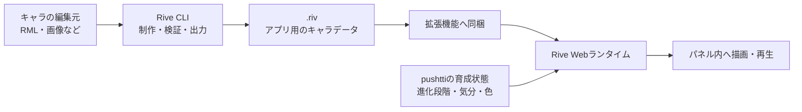

# Rive：CLIによる制作・Webランタイムによる描画

[技術一覧へ戻る](../README.md#technologies) · [Chrome拡張機能の説明へ](chrome-extension.md)

キャラを制作し、Chrome内で描画する仕組みを説明します。

## 制作と表示の役割

**Rive CLIはキャラを作る道具、Webランタイムは作ったキャラを表示するためのプログラムです。**

## Rive CLI：制作する時に使う

RMLというテキスト形式などで、体の形、パーツ、アニメーション、状態の切り替えを記述します。CLIはそれをアプリ用の `.riv` ファイルへ変換します。編集元はGitで管理し、変更内容を追えるようにします。

最初のキャラは1系統・3段階です。幼体の丸い姿から、手足や角が発達し、成体では立ち姿や目元も凛々しくなる方向で制作します。キャラの色はリポジトリごとに固定します。

### 編集元とアプリ用データの違い

| データ | 用途 |
| --- | --- |
| RMLなどの編集元 | 体の形、パーツ、動き、状態の切り替えを制作・修正する |
| `.riv` | Webランタイムが読み込み、アプリ内で描画するための出力データ |

キャラを変更する時は、編集元を直してから再び `.riv` を出力します。育成中の経験値を `.riv` に書き込むわけではありません。キャラのデザインはRive側、育成データはChrome側で管理します。

### 制作から拡張機能への組み込みまで

1. 体の形・パーツ・アニメーションと、状態を切り替える仕組みを編集元に記述する。
2. CLIで内容を検証し、プレビューや画像出力で姿と動きを確認する。
3. 幼体・成長期・成体、各体調、色違いを確認する。
4. アプリ用の `.riv` を出力する。
5. `.riv` とWebランタイムを、[WXT](chrome-extension.md#wxt)で拡張機能へ同梱する。

キャラの編集元と、出力時に使う設定はGitで管理します。利用中のキャラをGitHubのコミットごとにCLIで作り直す必要はなく、表示に使う状態をWebランタイムへ渡して切り替えます。

参考：[Rive CLI公式説明](https://rive.app/docs/cli/overview)

## Rive Webランタイム：キャラを表示する時に使う

Webランタイムは、`.riv` の内容を読み取り、ブラウザーの描画領域にキャラを表示します。pushttiが「成体にする」「喜ぶ状態にする」「この色にする」と情報を渡すと、対応する姿や動きを再生します。

経験値や死亡を決めるのはpushttiの育成処理です。Webランタイムは、その計算結果に合う見た目を表現します。パネルを閉じている間は通常のアニメーションを停止し、キャラを常時動かし続けない設計にします。

利用者がRiveのエディタやCLIをインストールする必要はありません。再生に必要なプログラムとキャラデータは拡張機能に含めます。

参考：[Rive Webランタイム公式説明](https://rive.app/docs/runtimes/web/web-js)

### 表示時に受け取る情報

| Chrome側から渡す情報 | 表示にどう使うか |
| --- | --- |
| 進化段階 | 幼体・成長期・成体の姿を切り替える |
| 気分・体調 | 通常・喜び・寂しさ・弱り・死亡に合う表情や動きを選ぶ |
| リポジトリごとの固定色 | キャラの色を切り替える |

たとえば、Chrome側が「経験値が100に達した」と判定したら、進化段階を成長期へ更新します。Webランタイムはその結果を受けて、成長期の姿を描きます。GitHubからコミットを取得する処理や、経験値・死亡を判定する処理は、[Chrome側の背景処理](chrome-extension.md)が担当します。

### ブラウザーで描画する仕組み

Webランタイムは、JavaScriptとWebAssembly（WASM）で構成されています。JavaScriptはブラウザーで動くプログラム、WASMはブラウザーが実行できる形式のプログラムです。Webランタイムがこれらを使って、`canvas`という描画領域にキャラを表示します。

pushttiでは、詳細パネル内にこの描画領域を置きます。経験値やコメントの文字情報はReactで表示し、キャラの形・表情・アニメーションはRiveで表示します。

ランタイムとキャラデータは拡張機能へ同梱し、表示するたびに外部サイトから再生用プログラムを取得しない構成にします。

### パネルを開く・閉じる時の流れ

1. パネルを開いたら、保存済みの育成状態を読み、同梱した `.riv` を表示できるように準備する。
2. 進化段階・気分・色をWebランタイムへ渡し、キャラを描画する。
3. 表示中に育成状態が変わったら、受け渡す状態を更新する。
4. パネルを閉じたら、通常のアニメーションを停止する。
5. 別のリポジトリへ移動した場合は、そのリポジトリの状態へ切り替える。不要になった描画処理は破棄する。

パネルを閉じても、保存した経験値や世代は残ります。アニメーションの停止と、育成データの削除は別のことです。

## 歴代キャラの保存とのつながり

歴代キャラの姿を画像化する処理は、描画できるパネル側が担当します。背景処理が直接キャラを描くわけではありません。

Chrome側には、最後に到達した進化段階・固定色・使用した素材のバージョンなど、姿を再現するための情報を保存します。パネルが閉じている時に死亡を判定した場合も、まずこの情報を残し、描画できる時に履歴用の画像を作成します。再現に必要な素材のバージョンも保持する方針です。

画像は[IndexedDB](chrome-extension.md#indexeddb)へ保存し、画像を取り出す識別子や死亡日などの情報は[chrome.storage.local](chrome-extension.md#storage-local)へ保存します。過去の姿を画像で残すことで、キャラのデザインを更新しても、歴代キャラの見た目を確認できるようにします。

